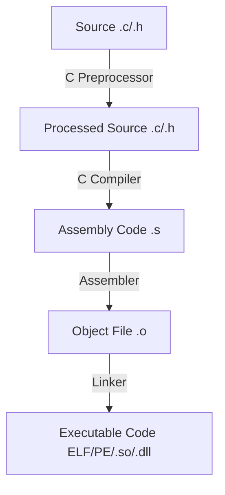

JQR Items
---
Information ending in [#.#] denote sections that covers a JQR item
ex:
- \<instructional information here\> [#.#]
- \<instructional information here\> [#.#, #.#, ...]

This instruction will not cover all the JQR items, and some of the sections are not covered in their entirety
- 6.1 for example has multiple components
<!-- end_slide -->

Overview
---
- Why C
- Program Execution
- The Road to "Hello, World!"
- Variables and Preprocessor Directives
- Arithmetic Operations
- Control Flow
- Functions & Scope
- Pointers
- Strings
- Main
- Building a "Buisness "Hello, World!"
- Input / Output
- Threading
<!-- end_slide -->

Why C
---
- General programming language
    - embedded, operating systems, user applications
<!-- new_line -->
- Low level of abstraction
    - large amount of control and system integration
<!-- new_line -->
- Compiled and Statically Typed
    - compiled code is faster and more portable than interpreted code
    - statically typed languages offer more compiler time gaurantee
<!-- new_line -->
- Simple
    - C has a small amount of keywords (~50)
    - complexity of higher level concepts is offloaded to the developer
<!-- end_slide -->

Program Execution -- How Operating Systems Run Code
---
- programs, our compiled code/application, are ran in a process
    - process: logical construct consisting of code and the required resources to run our code
<!-- new_line -->
- compiled code (our program) is loaded into process memory in chunks.
    - the format of the file matters. different operating systems expect their programs to be in specific formats
        - PE  -- portable executable -- windows [6.15]
        - ELF -- Executable and linkable format -- linux [6.15]
<!-- new_line -->
- the operating system executes the code at the "entry point" of loaded application (main) [6.1]
- process runs until terminated or it finishes execution
<!-- end_slide -->

Program Execution -- Memory Layout of a Linux Process
---
- placeholder for process map image
    - show / discuss stack
    - show heap, will discuss later
    - show bss/data/text section
        - discuss how code is loaded into text section
            - OS finds the entry point (main) and execution starts there
<!-- end_slide -->

The Road to "Hello, World!"
---
- Building and Toolchains [5.2, 6.15]
- Include Files && Libraries [6.1]
- hello_world.c File Review [6.1]
- Building our hello_world [6.1, 6.16]
- Executing our hello_world [6.1]
<!-- end_slide -->

The Road to "Hello, World!" -- Building and Toolchains
---
# The Good, The Bad, and The Ugly, the Really Ugly
- C is managed by a very technical and qualified working group
    - JTC1/SC22/WG14 - C
- Language updates can take years of planning before being finalized
    - 1989/90 C89/C90, 1999 C99, 2011 C11, 2018 C17/C18, 2024 C23
- Implementation details are left to third party tool developers
    - C11 standard includes built in support for threads, microsoft didnt add it to their implementation until 2023
- Implementation is platform specific and determined by a systems ABI (Application Binary Interface)
<!-- new_line -->
# Our Focus
- We will focus on Linux building and toolchains as the BCCD specifies linux in many of their items
- the tools used in this instruction are industry standard tools
- Many concepts apply to all systems with slightly different implementation
<!-- end_slide -->

The Road to "Hello, World!" -- Building and Toolchains
---
# Building our executables
- Executables and libraries need to be built to the standard of the platform they intend to be ran on
- This standard is known as an Application Build Interface (ABI). 
    - It specifies the format a file needs to be in, and how it interacts with the operating system and other code during runtime [6.15]
# File formats [6.15]
- Windows: Portable Executable (PE, .exe), Dynamically Linked Library (DLL, .dll)
- Linux: Executable and Linkable Format (ELF), Shared Object (.so)
<!-- end_slide -->

The Road to "Hello, World!" -- Building and Toolchains
---
# Build Process

<!-- column_layout: [1, 1] -->
<!-- column: 0 -->

<!-- column: 1 -->
# [6.15]
- C Preprocessor handles preprocessor directives
- Processed C source code is compiled or "translated" to assembly code
- an Assembler assembles the assembly to machine instructions
- a Linker "connects" or links separate code pieces together, resulting in an executable file

note: each of these stages is determined by the ABI and implemented by a 3rd party tool developer
<!-- reset_layout -->
<!-- end_slide -->

The Road to "Hello, World!" -- Building and Toolchains
---
# Tools we will use:
## Building
- `gcc` - GNU C Compiler, very powerful monolithic tool [6.16*]
    - Preprocessing, Compiling, Assembling, Linking
    - Can be very complex with over 1000 command line options
    - Individual steps can be triggered to observe side effects
- `cmake` - meta-build tool [6.17*]
    - compiler-independent instructions that can reproduce a build on a variety of platforms with a variety of compilers

## Debugging
- `gdb` - GNU debugger [6.16*]
    - powerfull command line debugger
    - allows you to "step through" execution of a program
- `valgrind` - Dynamic memory analysis tool [6.21*]
    - amazing for finding memory leaks

## Version Control
- `git` - distributed version control software system
    - manages versions of source code or data
<!-- end_slide -->

The Road to "Hello, World!" -- Include Files && Libraries
---
- It is good practice to write modular and reusable code
- Libraries are collections of reusable, executable code, that can be used in your program
- Include Files, or Header files, are files that provide code references in your source files
```c +line_numbers
#include <header file> // #include is a preprocessor directive

#include <stdio.h>    // includes standard input and output
#include <math.h>     // includes functions related to math
#include "my_file.h"  // includes a local file named my_file.h
```
- `<file>` -- angled brackets tell the compiler to look for these files in the "system include directories"
- `"file`" -- quoted includes tell the compiler to look in your local directory where you are building your binary
<!-- end_slide -->

The Road to "Hello, World!" -- hello_world.c File Review
---
```file +line_numbers +exec
path: code/hello_world.c
language: c
```
<!-- end_slide -->

The Road to "Hello, World!" -- Building our hello_world
---
# One step at a time [6.16]
```bash
# C Preprocessor
gcc -E hello_world.c -o post.c

# will translate C to assembly
gcc -S post.c -o assembly.s

# will assemble assembly to object file.
gcc -c assembly.s -o assembled.o

# will link object files into an executable
gcc assembled.o -o hello_world
```
# All at once [6.16]
```bash
gcc hello_world.c -o hello_world
```

```bash
# will include debug symbols
gcc hello_world.c -o hello_world -g 
```
<!-- end_slide -->

The Road to "Hello, World!" -- Executing our hello_world
---
```bash
# execute hello_world
./hello_world

# run hello_world through valgrind [6.21]
valgrind --leak-check=full ./hello_world

# run hello_world through gdb debugger [6.16]
gdb ./hello_world
```
<!-- end_slide -->

Variables and Preprocessor Directives
---
- Syntax
- Data Types
- Signed vs Unsigned
- Fixed Size
- Arrays
- Enumerations
- Structures
- #define
<!-- end_slide -->

Variables and Preprocessor Directives -- Syntax
---
- A variable is a lable to a storage location in memory that holds data
- The name must be unique across variable names
- Variable types tell the compiler how to interperate the data at the location
- Variables do not have to be initialized -- but you *will*
    - uninitialized variables will hold junk data because operating system optimizations.
- use cases: store results to operations, report statuses, store information for later use
- variables reside in the region of memory called the stack
```c +line_numbers
<type> <name> [= <initialization value>];
int my_int;           // [6.3]
int my_other_int = 5; // [6.3]
```
<!-- end_slide -->

Variables and Preprocessor Directives
---
- placeholder slide for showing variables on the stack, and holding potential junk data
    - demonstrate variables are a label to a memory address
    - the memory address is determined by the Stack Pointer + Stack Offset
<!-- end_slide -->

Variables and Preprocessor Directives -- Data Types
---
- data type: defines the type of data stored at a variable location
- when declaring a variable, the type also tells the compiler how much space to allocate on the stack
- data types vary in the amount of memory they occupy, how they are interpreted by the CPU, and how we as developers interact with the data

```c +line_numbers
// [6.3]
char  my_char          = 'E'; // Smallest addressable unit of memory. 1 byte == 8 bits
short my_short         = 5;   // 2  byte signed integer type
int   my_int           = 67;  // 4  byte signed integer type
long  my_long          = 2;   // 8  byte signed integer type
long long my_llong     = 9;   // 16 byte signed integer type
float     my_float     = 4.4; // 4  byte floating point decimal type IEEE 754 single-percision binary format
double    my_double    = 6.7; // 4  byte floating point decimal type IEEE 754 double-percision binary format
long double my_ldouble = 6.7; // IEEE 754 quadruple-percision floating point binary format
```

- caveat with these built in data types: their size has been "normalized" but it is not guaranteed. this is due to very old computing lore, and different processor types having different accessable sizes of memory
<!-- end_slide -->

Variables and Preprocessor Directives -- Data Types - Signed vs Unsigned
---
# Signed data types
- previous slide showed various data types that can hold positive or negative values
```c +line_numbers
int x; // range is [−32767, +32767]
```
- the very first bit determines if the value in this variable is positive or negative.
- this method of using the first bit to determine positive vs negative is known as Two's Complement
- using this first bit limits the magnitude of value in the positive or negative direction, but allows for negative values

# Unsigned data types
- a variable can also be declared `unsigned`. this removes the first bit being used for positive/negative increasing the magniture in value in the positive direction
- only positive values can be represented with `unsigned` variables
- the same *range* of values can be represented, only the *magnitude* in the positive direction is altered
```c +line_numbers
unsigned int x; // range is [0, 65535]
```
<!-- end_slide -->

Variables and Preprocessor Directives -- Fixed Size
---
- Fixed size data types occupy a fixed amount of space in memory
- due to old computer lore, an `int` on one machine might be a different size than an `int` on another machine
- when these systems communicate, data corruption can occur due to these size differences
- the solution to this problem is using a set of data types that are fixed in size regardless of the system
- the C solution is the `stdint.h` library

```c +line_numbers
#include <stdint.h>

// [6.4]
uint8_t my_uint8;   // fixed size 8 bit integer
int8_t my_int8;
uint16_t my_uint16; // fixed size 16 bit integer
int16_t my_int16;
uint32_t my_uint32; // fixed size 32 bit integer
int32_t my_int32;
uint64_t my_uint64; // fixed size 64 bit integer
int64_t my_int64;
```
<!-- end_slide -->

Variables and Preprocessor Directives -- Arrays
---
- arrays are a way to declare multiple of the same type of variable with the same label
- arrays are a contiguous space in memory, meaning each instance of the declared variable type is directly next to the previous instance
- arrays are a fixed size at build time.
- the array lable is a label to the first address of the contiguous space in memory
- after array decleration, it is up to the developer to keep track of the length of the array
```c +line_numbers
// [6.15]

/*
type lable[size];
type lable[size] = [initial values];
*/

// create an uninitialized int array with size 10
int my_int_array[10];

// create an int array with initialized values
int my_int_array[10] = {0, 1, 2, 3, 4, 5, 6, 7, 8, 9};

// create an int array initialized with all 0s
int my_int_array[10] = {0};
```
<!-- end_slide -->

Variables and Preprocessor Directives -- Arrays
---
- placeholder slide for contiguous space in memory on the stack
<!-- end_slide -->

Variables and Preprocessor Directives -- Arrays
---
- assigning values to specific array elements is done through the index operation
- counting in C, and most programming languges start at 0.
- when indexing an array, the first element is 0, and the last element is `size - 1`
```c +line_numbers
// [6.15]

int my_int_array[10]; // declare a size 10 integer array
my_int_array[0] = 5; // set the 0th index to 5
...
my_int_array[9] = 67;

my_int_array[10] // ? -- this will lead to an out of bounds runtime error
```
- the runtime error is an example of C being simple, but offloading complexity to the developer
- when contiguous spaces in memory are instantiated, there is no reliable way to determine the size after the fact.
- it is up to developers to check expected bounds or run into out of bounds errors

<!-- end_slide -->

Variables and Preprocessor Directives -- Arrays
---
- Arrays can be "multidimentional"
- Logical construct for manaing "rows and colums", or "X, Y, Z" for 2 dimentional, or 3 dimensional arrays respectively
```c +line_numbers
// [6.15]

// creates a 2 dimensional array with 5 indicies of each contains 6 indicies
int my_2d_int_array[5][6];  // this array has 30 total memory locations
my_2d_int_array[0][0] = 67; // sets the value at [0][0] to  67
```
- Multidimentional arrays are "syntactic surgar", or a language feature that logically encapsulates more complex operations
- multidimentional arrays are still contiguous. they don't actually take up a 2d, 3d, or nd space in memory
```c +line_numbers
// both of these arrays create the same size contiguous space
int my_2d_int_array[5][6];
int my_1d_int_array[30];

// both of these index the same offset in memory
my_1d_int_array[14] = 67;
my_2d_int_array[2][1] = 67;
my_2d_int_array[14] = 67;

int example[A][B];
example[C][D] = 67; // index = (C * A) + D
example[(C * A) + D];
```
<!-- end_slide -->

Variables and Preprocessor Directives -- Arrays
---
- placeholder slide for 2d array indexing a 1d continuous space
<!-- end_slide -->

Variables and Preprocessor Directives -- Enumerations
---
- Enumerations are a user define data type that contain a set of named integer constants
- numeric values take up less computational work and require less logical complexity to manage
- enumerations allow you to label data in a human readable way while keeping the efficiency of integer types
```c +line_numbers

// demonstrates declaring an enum and various ways of labeling the values
enum color {
    red,
    BLUE,
    COLOR_GREEN
};
```
<!-- end_slide -->

Variables and Preprocessor Directives -- Structures
---
- structures `struct` in C are a way to aggregate multiple data types into one label
- structs also occupy contigious spaces in memory, but the layout is not guaranteed
- structs must be defined before they can be declared or instantiated
```c +line_numbers
struct name {
    type label;
    type label;
    ...
};

enum Color {
    RED,
    GREEN,
    BLUE
};

struct vehicle {
    enum Color color;
    unsigned int wheels;
    unsigned short doors;
};

struct vehicle car;
car.color = RED;
car.wheels = 4;
car.doors = 2;
```
<!-- end_slide -->

Variables and Preprocessor Directives -- Structures
---
# C99 Syntax for struct instantiation
```c +line_numbers
enum Color {
    RED,
    GREEN,
    BLUE
};

struct vehicle {
    enum Color color;
    unsigned int wheels;
    unsigned short doors;
};

// C99 syntax for instantiating a variable with values
struct vehicle car = {
    .color = RED,
    .wheels = 4,
    .doors = 2
};
```
<!-- end_slide -->

Variables and Preprocessor Directives -- #define [6.19]
---
- #define is a preprocessor directive that can associate a label to a value
- during the C preprocessor phase, the value will replace all instances of the label
- CANNOT be modified after build time
- common usage when a value is pre-known, doesn't change, and to add clarity to code, similar to the clarity added by defining an `enum`

```c +line_numbers
#define <label> <value>
#define SCORE_SIZE 10

int scores[SCORE_SIZE];
```
<!-- end_slide -->

Variables and Preprocessor Directives -- #define
---
- perform #define preprocess demo
- placeholder for where define values are stored in the binary
- we did it, we beat variables (and #define)
<!-- end_slide -->

Arithmetic Operations
---
- Assignment / Addition / Subtraction / Multiplication
- Division
- Casting
- Modulus
- Post/Pre Increment/Decrement
- Order of Operations
- Code Evaluation
<!-- end_slide -->

Arithmetic Operations -- Assignment / Addition / Subtraction / Multiplication [6.6]
---
- the result of an arithmetic operation is the type of the assignment variable
- when dealing with integer values, the result will be "coersed" to the return type
- more restrictive data types can be coersed into less restrictive data types with no loss of data
- ensure the resulting data type can hold values of the magnitude of the result
```file {4-6 | 8,9 | 11,12 | 14,15} +exec +line_numbers
path: code/add_sub_mult.c
language: c
```
<!-- end_slide -->

Arithmetic Operations -- Division [6.6]
---
- Division is an example where data can lose percision or value when performed
- the division of two integers
```file {4-7 | 9,10 | 11,12 | 13,14 | 15,16} +exec +line_numbers
path: code/div.c
language: c
```
<!-- end_slide -->

Arithmetic Operations -- Casting
---
- Casting is the process of changing the interpretation of data (if a cast conversion is possible)
    - remember variables just label locations in data. the variable type insructs how to interpret that data.
    - casting is the temporary re-interpretation of the data at the variable location
- Implicit Type Casting - the compiler implicity coerces the data to match the scenario (as in the division example)
- Explicit Type Casting - the developer is explicit in their casting (as in the division example)
```c +line_numbers
(<new_type>)<variable | expression>

short data = 6;
(int)data;

int   a = 8;
float b = 7.7;

a / b;        // implicit
(float)a / b; // explicit 

(double)( a / b); // casting the result of an expression
```
<!-- end_slide -->

Arithmetic Operations -- Modulus [6.6]
---
- the modulus operator is sometimes refered to as the remainer operator.
```c +line_numbers
<result> = <int-expression> % <int-expression>

int result = 5 % 7 // 5 / 7   is 0 with a remainder of 5
int result = 7 % 5 // 7 / 5   is 1 with a remainder of 2
int result = 6 % 6 // 6 / 6   is 0 with a remainder of 0
int result = 36 % 6 // 36 / 6 is 6 with a remainder of 0
```
- modulus allows us to develop more complex functionality
```c +line_numbers
int value = <user provided input>
int odd-or-even = value % 2 // if divisiable by two with no remainder, it is even

int value = <random number from 0 -> INT_MAX>
value = value % 100 // will bound the number between 0-99
```
<!-- end_slide -->

Arithmetic Operations -- Postfix [6.6]
---
# Postfix
- postfix operations are a short-hand way of incrementing or decrementing a value without tedious syntax
- postfix operations increment the value after it is evaluated
```c +line_numbers
// without postfix
int a = 10;
a = a + 1; // incrementing a value by one

// with postfix
// here a = 11; a evaluates to 11, then is incremented to 12
a++; 

// here a is evaluated to 12, then it is incremented to 13. the 12 value is then used in the rest of the operation
// b = 7 + a++
// b = 7 + 12 -- the value 12 is used in the rest of the expression, where the data held by a is incremented
// b = 19
int b = 7 + a++;
b--; // you can also decrement the value
```
<!-- end_slide -->

Arithmetic Operations -- Prefix [6.6]
---
# Prefix
- prefix operations are similar to postfix, except they increment/decrement their value THEN their value is evaluated
- prefix operations reduce code clarity, and should be avoided
```c +line_numbers
int a = 10;
++a; 
--a;

// here a is incremented to 11, then it is evaluated. the 11 value is then used in the rest of the operation
// b = 7 + ++a
// b = 7 + 11 -- the value 11 is used in the rest of the expression
// b = 18
int b = 7 + ++a;
```
<!-- end_slide -->

Arithmetic Operations -- Order of Operations [6.6]
---
# Order of Operations
- `++, --`   - Suffix/Postfix increment and decrement - Left-to-Right
- `++, --`   - Prefix increment and decrement         - Left-to-Right
- `()`       - Parentheses
- ` *, /, %` - Multiplication, Division, Modulus      - Left-to-Right
- `+, -`     - Addition, Subtraction                  - Left-to-Right

# pro-tip
- liberally use parenthese to bring clarity to mathematical expressions
- avoid `++, --` PREFIX operations. modifying variables in place before an operation greatly reduces code clarity
<!-- end_slide -->

Arithmetic Operations -- Code Evaluation [6.1, 6.6, 6.*]
---
# What is Code Evaluation
- Code evaluation is how a line of code resolves, and how you can interact with the resolution of that code
- the previous example demonstrated casting a variable or an expression: `(<new_type>)<variable | expression>`
- it would be more accurate to just say: `(<new_type>)<expression>`
- become familiar with the grammar of C even if it isnt explicitly a JQR item. understanding the evaluation of code will only make you a better developer

# References
- What is EBNF:
    - https://en.wikipedia.org/wiki/Extended_Backus%E2%80%93Naur_form
- C99 Standard:
    - Annex A of C99 contains the grammar: https://www.open-std.org/JTC1/SC22/WG14/www/docs/n1256.pdf
- a quick reference found on google
    - https://cs.wmich.edu/~gupta/teaching/cs4850/sumII06/The%20syntax%20of%20C%20in%20Backus-Naur%20form.htm
- order of operations of all C stuff
    - https://en.cppreference.com/w/c/language/operator_precedence.html
<!-- end_slide -->

Control Flow [6.1, 6.12*]
---
# Relational Operators
# Conditional
- `if`
- `else`
- `else if`
- `switch`

# Iterating
- `for`
- `while`
- `do while`

- `continue` && `break`

# Unconditional
- `goto`
<!-- end_slide -->

Control Flow -- Relational Operators and Boolean Logic
---
- Operators used to compare items.
# Precedence
- `!` -- logical not
- `<`, `<=`, `>`, `>=`     - left-to-right
- `==`, `!=`           - left-to-right
- `&&` -- logical and
- `||` -- logical or

# Simplified Grammar
```
result = <expression> <relational | boolean-logic> <expression>
```
# Results
- results are true/false, but represented as non-zero, and zero
    - C didnt start with a boolean (true or false) value, 1/0 were used instead
    - C99 and later can `#include <stdbool.h>`, which is just a typdef for true/false to 1/0
    - even with `stdbool` all non-zero values are considered "truthy", while 0 is the only false
# Used heavily in the following control flow constructs
<!-- end_slide -->

Control Flow -- Boolean Logic
---
- boolean logic is the analysis of multiple logical expressions into a boolean result
- Logical NOT `!` will 'flip' or negate the result of the operand following directly after
- Logical AND `&&` results in a true if both operands are true. the result is false otherwize
- Logical OR `||` results in a true if either operands is true. the result is false only if both operands are false
- Just like with relational expressions, the operands of boolean logic can themselves be complex expressions
```c +line_numbers
#include <stdbool.h>
#include <stdio.h>
bool my_bool = true;
!my_bool;           // resolves to false
my_bool = my_bool!; // resolves to false, then assigns it back to my_bool

bool b_result = true && true; // evaluates to true (1)
int i_result = 3 && 7;        // evaluates to true (1)
int result = 0;

b_result = true && false;     // evaluates to false (0)
i_result = 0 && 7;            // evaluates to false (0)

result = 0 || 1 // evaluates to true
result = 1 || 0 // evaluates to true
result = 0 || 0 // evaluates to false
```
<!-- end_slide -->

Control Flow -- if
---
# What is control flow?
- code executes one line at a time, top to bottom.
- control flow gives us a structured approach to "jumping" through the order of instruction based on conditions
# if statements
```c +line_numbers
// grammar
if (<expression>) <statement>

// syntax
// only valid for a single line of code
if (<expression>)
    <statement>

// this one is best, even if only a single line of code
// it has better clarity
if (<expression>) {
    <statement>
}
```
- in this instance, the result of the `<expression>` in parentheses is either 0, or not zero.
    - this type of expression which controls program execution will also be refered to as a `<conditional-expression>`
- the following `<statement>` is only evaluated if the expression in the parenteses resolves to 'true'
<!-- end_slide -->

Control Flow -- if/else
---
- `if/else` is a control flow construct that creates a "this-or-that" situation
- this differs from a regular `if`, in that if the condition is false, the statements in the else section are executed
```c +line_numbers
// grammar
if ( <expression> ) <statement> else <statement>

// syntax
// only valid for a single line of code
if ( <expression> ) 
    <statement>
else
    <statement>

// this one is best, even if only a single line of code
// it has better clarity
if ( <expression> ) {
    <statement>
} else {
    <statement>
}
```
<!-- end_slide -->

Control Flow -- if/else if
---
- `if / else if` is a control flow construct that creates a "this, or conditionally that" situation.
- the `that` part of a traditional `this-or-that` is conditionally evaluated
- this allows for the construction of more complicated logical code execution paths
```c +line_numbers
if (conditional-expression) {
    statement;
} else if (conditional-expression) {
    statement;
}
```
<!-- end_slide -->

Control Flow -- if/else/else if examples
---
```c +line_numbers
int main(int argc, char **argv) {
    if (3 != argc) {
        printf("not enough arguments\n");
        exit(-1);
    }

    // do stuff with arguments
    return 0;
}
```
<!-- end_slide -->

Control Flow -- if/else/else if examples
---
```c +line_numbers
#include <stdlib.h>
#include <time.h>

int main(int argc, char **argv) {
    srand(time(NULL));

    // the conditional-expression is the result of a function call and a math operations
    // function calls have a higher precedence of operations than the modulus operator
    // rand() resolves to a random positive number
    // the random value is then divided by 2. if there is a remainder (1), the number was odd
    if (rand() % 2) {
        // number is odd
    } else {
        // number is even
    }
}
```
<!-- end_slide -->

Control Flow -- if/else/else if examples
---
```c +exec +line_numbers
#include <stdlib.h>
#include <stdio.h>
#include <time.h>

int main(int argc, char **argv) {
    srand(time(NULL));

    int value = rand();
    value = value % 1000;
    if (value % 2) {
        // number is odd
        printf("%d is odd\n", value);
    } else if (value > 500){
        // number is even
        printf("%d is a big even number\n", value);
    }
}
```
<!-- end_slide -->

Control Flow -- switch statements
---
- switch statements are a control flow construct that condense the syntax of multiple if/else if statements
```c +line_numbers
int value = <expression>;

if (1 == value)
{
    <statement>
}
else if (2 == value)
{
    <statement>
}
else if (3 == value)
{
    <statement>
}

switch (value) {
    case 1:
        <statement>
        break;
    case 2:
        <statement>
        break;
    case 3:
        <statement>
        break;
    default:
        <statement>
        break;
}
```
- switch statements are more than just syntactic sugar, they compile into a a jumptable which can perform less conditional checks when determining the logical flow of code execution
<!-- end_slide -->

Control Flow -- for loop
---
- loops are a language concept that allows iteration over a section of code for a conditional amount of time
    - iteration: repeating a process to generate a sequence of outcomes. each each repetition is a single iteration.

- for loops allow you to iterate "for" a specified set of conditions.
```c +line_numbers {1-3 | 5-7 | 9-11}
    for (<initializations>; <condition>; <post_processing>) {
        <statements>;
    }

    for (int i = 0; i < 10; i++) {
        printf("%d\n", i);
    }

    for (int i = 0, int j = 0; i < 10 && j < 10; i++, j++) {
        printf("%d * %d = %d\n", i, j, i * j);
    }
```
<!-- end_slide -->

Control Flow -- while loop
---
- while loops allow you to iterate "while" a condition is true.
```c +line_numbers 
while (<conditional-expression>) {
    <statements>;
}

int value = <user input>;
while (value) {
       /*
        do something. maybe modify the value.
        this will continue to loop until value == 0
       */
       value--;
}
```
- but wait, couldnt i just do a for loop? yes you can.
- for loops and while loops are different logical representations of iteration
- for/while loops may even compile to the same assembly
```c +line_numbers
int value = <user input>;

for (int i = 0; i < value; i++)
for (; value > 0; value--)
```
- use whatever brings the most clarity to the code
<!-- end_slide -->

Control Flow -- do/while loop
---
- a do/while loop is almost identical to a while loop, but used in situations where the iterative statement needs to execute at least 1 time
```c +line_numbers
do {
    <statemetns>;
} while (<conditional>);

int value = 0;
do {
    value = <get user input>;
    <do something with user input>
} while (value != 0);
```
- all three of these looping mechanism allow you to implement iterative control flow.
- they can normally be used interchangably, and the best option is which one brings the most clarity

<!-- end_slide -->

Control Flow -- `break` && `continue`
---
`break`    - keyword to "break" the iterative execution flow, and continue code execution outside the `while` or `for` loop
`continue` - keyword to "continue" the iterative execution flow, immediately restart the loop on the next iteration

```c
int x = 0
while (1) {
    x = rand() % 100;
    if (x > 75) {
        break;
    }
}
// break "breaks" the loop and execution happens here

for (int i = 0; i < 100; i++) {
    if (i % 2 == 0) {
        // if i is even, go to the next iteration (increment i and start again)
        continue; 
    }

    // this will only print odd numbers
    printf("%d\n", i);
}
```

<!-- end_slide -->

Control Flow -- goto
---
- `goto` is an uncoditional control flow mechanism
- code can `goto` a label that is defined in the same function-scope (more on scope later)
```c +line_numbers
// this will unconditionally "jump" code execution to the label
goto <label>

// this is label definition
<label>:
```

```c +line_numbers
int main(int argc, char **argv) {
    if (argc != 2) {
        goto END;
    }

    // do a bunch of stuff if argc IS 2

END:
    return 0;
}
```
- an example like this `goto END;` statement reduces the 'cyclomatic complexity' of the code.
    - https://en.wikipedia.org/wiki/Cyclomatic_complexity
- `goto` statements have a multitude of valid uses that will be reviewed later
<!-- end_slide -->

Control Flow -- goto
---
- placeholder slide for instruction pointer demonstration
- discuss code section of memory executing one instruction at a time
- conditional statements `jmp` modify the instruction pointer in a non-linear way
<!-- end_slide -->

Functions & Scope
---
- Scope
- Functions
<!-- end_slide -->

Functions & Scope - Scope!
---
- so far, we have been labeling thing: variables, structs, enums, struct defintions, and variable definitions
- these labels can only be used in portions of code that share the same `scope`.
- labels are only visibile to other parts of code that share the same `scope`
- there are 4 types of scope:
    - Function, File, Block, Function-Prototype

```file +line_numbers
path: code/scope.c
language: c
```
<!-- end_slide -->

Functions & Scope - Scope!
---
- block scope has implications for our previously mentioned switch/if/else/while/for control flows
- variables, or labels created inside of the `{}` only exist inside the brackets of the respective control flow
- labels created in the `conditional-expression` of a control flow only exist in the block scope of the control flow
- block scope is not the same as function scope.
- block scope is a compile time logical convienence
```c +line_numbers
if (<conditional-expression>) {
    int a = ...;
}
// a is out of scope

// int i only exists in this loop
for (int i = 0; i < ...; i++) {
    // b only exists in this loop
    int b = ...;
}

while (int a = <expression>) {
    // a is in scope;
}
// a is out of scope
```
<!-- end_slide -->

Functions & Scope - Functions
---
- code is loaded into the text or code section of process memory
- a special register in the CPU called the Program Counter, or Instruction Pointer keeps track of the memory address of the next instruction to run
- functions area a mechanism to label a region in code so that it can be reused multiple times
- functions evaluate to the data they return;
    - the data returned is COPIED to the callers function scope
```c +line_numbers
/*
function syntax for a function with no parameters
<return type> <label>() {
    <statements>

    return <data of return type>
}

 function syntax for a function with up to n parameters
<return type> <lablel>(<param type> <label>, ...)
*/

// this function takes two int parameters, and will be refered to in the
// function as a and b.
// parameter values are COPIED into the function scope. demonstration later.
// to change values of parameters use pointers! -> next major section
int add_numbers(int a, int b) {
    return a + b;
}
```
- when declaring a function you must have the following components:
    - return type: if the function returns nothing, the return type is `void`
    - function label: the label must be unique in the scope in which the function was declared
    - `()`: open and closed parentheses, with optional parameters
        - function parameters are a comma separated list of `<type> <label>`
        - function parameters have function scope
    - `{...; return <>;}`: a function body, with a return keyword returing optional data
<!-- end_slide -->

Functions & Scope - Functions
---
- looking back at our hello_world
- main is a function label the operating system is expecting for your executable to run
- the parameters to main are provided by the operating system at program execution
- the data in the parameters are available in the scope of main as `argc` and `argv`
- main returns an `int`. this `int` will inform the operating systme is program execution was successfull
```file +line_numbers
path: code/hello_world.c
language: c
```
<!-- end_slide -->

Functions & Scope - Functions
---
- placeholder for function stack frame demonstration
    - demonstrate the instruction pointer in the text section of process memory "jumping" to the called function"
    - demonstrate a new stack frame being created, and the stack pointer being "moved" to the base of the new stack frame
    - demonstrate how parameter *values* are *copied* in to the new stack frame
    - demonstrate how when the function returns, the stack frame is moved back to its original position and function local variables (and paramters) are no longer *visible*
    - changes to function local variables have no effect on caller local variables
<!-- end_slide -->

Functions & Scope - Function Prototypes
---
- function prototypes are a feature that allows you to declare a functions specification separate to its implementation
- the functions specification, refered to as a `function prototypes` has the following syntax
```c +line_numbers
<type> <lable> (<optional parameters>); // note the semi-colon at the end, and no function body

int sum(int my_int_array[], int size); // this is also how you specify an array as a parameter

int calculate_area(struct rect my_rect);

int main(int argc, char **argv) {
    // functions whose prototypes have been declared can be used here
}

int sum(int my_int_array[], int size) {
    // implement function body here
}
```
<!-- end_slide -->

Functions & Scope - Function Prototypes, File Scope, and Linking
---
# prototypes
- `function prototypes` give us the ability declare a function and provide the implementation later
    - the function implementation does not need to be as c source code
    - source implementation can be provided in a separate file
    - the implementation needs to be provided by the linking phase of the build process
    - the implementation can be already compiled and assembled, and linked during the build process

# file scope
- when including a header file (.h) for a library, the convention is that .h files only contain definitions or declerations
    - `#defines`, `function prototypes`, `file scope variables`
- during the c preprocessor phase, include files are "inserted" into the source file, adding those definitions to the current file scope

# linking
- if the implementation to a `function prototype` is in another source file, it can be provided at build time
```bash
gcc main.c hello.c -o hello_world
```

- the standard libraries for C are shipped as pre-compiled executable code and header files
- the header files contain the specifications to the compiled code
- when `#include` is used, `gcc` will look in known system locations for the compiled code to `link` code references into the final executable
<!-- end_slide -->

Functions & Scope - Function Prototypes, File Scope, and Linking
---
- placeholder for file linking demonstration/image
<!-- end_slide -->

Pointers
---
- 
<!-- end_slide -->

Pointers
---
# pointers
- pointers are a variable type that hold a memory address
- memory addresses are normally represented as hex numbers
```c +line_numbers
/*
<type> *<label> [= <optional initialized value>];
*/

#include <stddef.h>
int *a; // [6.11]
int *b = NULL; // NULL is defined in stddef.h and is technically 0x0 or 0;
```
- pointers can be used as function arguments
```c +line_numbers
/*
some_function takes an integer pointer and a `struct vehicle` pointer
*/
int some_function(int *a, struct vehicle *car);
```

# okay, so whats the point? what do i do with pointers?
<!-- end_slide -->

Pointers
---
# the point(ers)
- memory access is slow (relatively speaking)
- functions *copy* their values into function scope, and this copy process can be slow
    - why not just `reference` the data that is already on the stack?
- what if you want a function that can return a status code, AND modify some input parameters?
- what if you want your function to return a larger amount of data (a struct or an array) and copying that would be slow

# referenceing data
- referencing data is a method of retrieving the memory address of a scope local variable or label
- referencing is done with the `&` reference unary operator
```c +line_numbers
#include <stddef.h> // include for NULL definition.

/*
a is label to a memory address on the stack. it evaluates to 5
*/
int a = 5;

/*
a_ptr is a label to a memory address on the stack. its data type is a pointer to an integer
*/
int *a_ptr = NULL;

/*
the right hand expression evaluates to the memory address that the label `a` points to
the pointer is then saved at the memory address `a_ptr`
*/
a_ptr = &a;
```
<!-- end_slide -->

Pointers
---
# dereference operator
- how does a pointer to data allow you to modify that data?
- the dereference urinary operator `*` resolves a pointer to the data located at the address
- note: the `*` symbol is used in multiple places in C which can cause ambiguity
    - multiplication
    - pointer decleration
    - function decleration the return pointers
    - and in dereferencing a pointer

```c +line_numbers
int a = 5;
int *a_ptr = &a;

/*
the left hand expression evaluates to the memory location that a_ptr holds as a value
the assignment operator assigns the value 6 to the memory location a_ptr holds
*/
*a_ptr = 6; //[6.11]

/*
using an assignment on a pointer without the dereference operator changes the
memory location a_ptr holds, and not the values at the pointers address
*/
a_ptr = 6;
```
<!-- end_slide -->

Pointers
---
- placeholder slide to demonstrate previous slides stack
<!-- end_slide -->

Pointers
---
# putting it into action
```file +exec +line_numbers
path: code/pointers_pass_by_reference.c
language: c
```
<!-- end_slide -->

Pointers
---
- placeholder slide for demonstration
- discuss the stack variable addersses being copied into the function scope
- the address is then dereferences to modified the value, changing the data in the caller scope
<!-- end_slide -->

Pointers
---
# Pointers and Arrays
- in C, Arrays are a label to the start of a contiguous space in memory
- when an array is passed to a function, it "decays" to a pointer
- arrays are "syntactic surgar" to logically wrap pointer arithmetic
- there are instances where pointer arithmetic is a predered method of accessing data

# Pointer Arithmetic
- when a pointer (or an array) is declared, a type definition is required
- type definition is used to ensure enough space is allocated to house the pointer, or enough items in an array
- the type definition is also used to ensure traversal or indexing of the pointer/array happens at the correct offsets
<!-- end_slide -->

Pointers
---
```c +line_numbers
// [6.11]
int sum(int array[], int size) {
    int total = 0;

    for (int i = 0; i < size; i++) {
        /*
            the array variable holds the address to the first item in the contiguous
            space holding the array values. addition and subtraction on a pointer
            indexes the contiguous space in memory by (i * sizeof(type))

            because this pointer/array is declared as an integer, the evaluation of the
            parenthese is the base memory address plus i int sizes

            the `()` evaluation is a memory address i ints in from the base. that address is dereference
            to the value at that index.

            this is syntactically equivalent to array[i]
            c99 specification 6.5.2.1: E1[E2]is identical to (*((E1)+(E2)))

            you can technically do index[array]... but dont
        */
        sum += *(array + i);
        // sum += array[i];
    }

    return total;
}
```
<!-- end_slide -->

Pointers
---
- placeholder for image / demonstration
<!-- end_slide -->

Pointers
---
# Dynamic Memory Allocation
- dynamic memory allocation answers a couple questions
    - how do I create a dynamically sized array? one without a fixed size at build time?
    - how do I write functions that return variable sized data?
    - whats this heap thing, all we talk about is the stack?

# The heap
- so far, all our variables have been allocated on the stack. when we declare a variable, be it an array, a pointer, a struct, etc..., the memory for those variables exists on the stack.
- the heap is a separate part of process memory where the developer can dynamically allocate memory that will be managed by the developer.
- allocations of memory on the stack when declaring a variable is known as "automatic allocation" vs heap memory which is "dynamically allocated" [6.1]
- the c standard library provides a few libraries for memory management, with `stdlib.h` containing the functions we will use most.
<!-- end_slide -->

Pointers
---
# malloc [6.21]
`void *malloc(size_t size)`

- malloc is a great segue to man pages!
- malloc is a function that allocates `size` bytes of contiguous memory and returns a pointer to the start address
- the return type of `malloc` is `void *`, meaing it's a pointer to data, the developer knows what is there because they called the size (in bytes)
- the data pointed to by `malloc` exists somewhere on the heap, rather than the stack
- the `sizeof(<type>)` can help allocate memory of the appropriate size. it yields the size in bytes of the type provided
    - do NOT use `sizeof(<variable>)` -- this is bad practice, adds ambiguity, and introduces bugs into your code
```c +line_numbers
#include <stdlib.h> // this also contains a definition of NULL as 0x0

int *my_dynamic_array = NULL;
int size = <some user input>
my_dynamic_array = malloc( size * sizeof(int) );

// C89 REQUIRES you to cast the void pointer to the type of assignment
// this is also required by versions of C++, it is good practice to cast
// the output of memory allocation for the highest level of interoperability
my_dynamic_array = (int *)malloc( size * sizeof(int) );
```
## note: the memory allocated on the heap is UNINITIALIZED. it is junk data. whatever bytes existed on the heap before, exist there now.
- it is common to use `memset` to set the uninitialized data to 0
```c +line_numbers
#include <string.h> // memset is defined in string.h for old lore reasons

memset(my_dynamic_array, 0, size * sizeof(int));
```
<!-- end_slide -->

Pointers
---
# A note on memset
- in previous slides struct initialization was tedious if using pre c99 syntax, and cumbersom if using c99+ syntax.
```c +line_numbers
#include <string.h>

enum Color {
    RED,
    GREEN,
    BLUE
};

struct vehicle {
    enum Color color;
    unsigned int wheels;
    unsigned short doors;
};

struct vehicle car;

memset(&car, 0, sizeof(struct vehicle));
```
- the reference operator on the car variable will evaluate to the memory address (pointer) of the car
- the sizeof() expression will evauate to the size in bytes of the `struct vehicle`
- memset will set the value 0 in every location starting at the start address of car, for `sizeof(struct vehicle)` bytes
<!-- end_slide -->

Pointers
---
# calloc [6.21]
`void *calloc(size_t n, size_t size)`
- allocates memory for an array of `n` elements with each element being size `size`
- calloc differs from malloc in that the memory region allocated is zero'd
- pro: memory is initialized. con: `calloc` is slightly slower than `malloc`
- if you are going to initialize your memory anyways, just use calloc
- my opinion, calloc is best alloc(ation)
```c +line_numbers
#include <stdlib.h>

enum Color {
    RED,
    GREEN,
    BLUE
};

struct vehicle {
    enum Color color;
    unsigned int wheels;
    unsigned short doors;
};

int size = 0; 
struct vehicle *cars = NULL;
...
size = <non-deterministic value based on program execution>;
cars = (struct vehicle*)calloc(size, sizeof(struct vehicle));
```
<!-- end_slide -->

Pointers
---
# free [6.21]
`void free(void *_Nullable ptr)`
- remember that dynamic memory management is done entirely by the developer
- this includes releasing allocated resources back to the process/operating system
- free `free`'s the allocated memory
```c +line_numbers
#include <stdlib.h>

int *a = (int *)calloc(...);
...
free(a);
```
- the data still exists in the heap, but it is being marked as available
- if you have sensitive information held in a pointer (buffer) memset it before it is freed
- it is ALWAYS a good practice to set pointers to NULL after they have been freed
- calling `free` on an already freed pointer is undefined behavior and will likely lead to a `segmentation fault`
- calling `free` on a NULL pointer performs no operation. and is valid.
```c +line_numbers
#include <stdlib.h>

int *a = (int *)calloc(...);
...
memset(a, 0, <the size of a>);
free(a);
a = NULL;
```
<!-- end_slide -->

Pointers
---
# Always Be Checking (ABC) [6.21]
- all of these memory allocation functions will return a memory address on success and `NULL` on failure
- dereferencing a `NULL` pointer is undefined behaivor, and will likely result in a `segmentation fault`
- always check if memory allocation fails by checking for `NULL` (which is a define to 0x0)
## ABC ALL parameters for acceptable values, not just pointers [6.10]
```c +line_numbers
struct vehicle *cars = NULL;
...
cars = calloc(...);
if (NULL == cars) {
    // gracefully handle. if memory allocation fails, its probably best to
    // gracefully exit the application. perform cleanup as necessary
}

if (!cars) {
    // this is also valid syntax.
    // the ! operator on NULL or 0x0 (hex for 0) is 1
    // this is logically checking if cars contains a NULL pointer
}
```
- it is crucial to check function arguments that are pointers to see if they are `NULL` before operating on them
```c +line_numbers
int add_to_int(int *a) {
    int status = -1;
    if (NULL == a) {
        goto END;
    }

    *a = *a + 1;
    status = 0;
END:
    return status;
}
```
<!-- end_slide -->

Pointers
---
# realloc
`void *realloc(void *ptr, size_t size)`

- realloc will resize the block of memory pointed to by `ptr` to `size` bytes.
- if the new block of memory is larger, the new memory is uninitialized
- if there was not enough contiguous space, a new block of memory will be allocated and the data will be copied for you
    - in this case, your result ptr will be different than your argument ptr, and this situation must be handled
    - if sensitive data is being `realloc`d, and the block of memory is movied, there will be a copy of the sensitive source data in memory still

# valgrind
- `valgrind` is a sweet of tools for debugging and profiling programs
- can be used to detect the origin of memory leaks [6.21]
- compiling with debug symbols will yield more detailed results
<!-- end_slide -->

Pointers
---
# Double Pointers (or more)
- pointers and arrays are just contiguous spaces in memory that hold a specific type of data
- pointers can hold an array of pointers. this gives us a "dynamic n-dimentional array".
    - the inital space in memory is dynamic, each index can contain a pointer of size 1 or more
- an `n`-pointer is declared with `n` `*`s
```c +line_numbers
// this creates a double pointer
// this creates a stack variable that is a pointer to an int pointer
int **data = NULL;

// notice the cast of calloc's `void *` return to an `int **`
// also notice that this pointer is pointing to an int pointer, the sizeof type is `int *`
// data now points to a contiguous space on the heap, with each item being the size of an `int *`
// because calloc was used, each pointer contained in the contiguous space is already initialized to NULL
data = (int **)calloc(10, sizeof(int *));

// indexing a double pointer is the same as indexing a 1 or 2 dimentional array
// this is allocating the `zero` index, or the first `int *` and assigning it to the result of calloc
// notice that each item in the `int **` is an `int *`, which is why calloc is being cast to a single int pointer
// each item in the data[0] `int *` will be the size of an int
data[0] = (int *)calloc(10, sizeof(int));
```
- When calling `free` to clean up memory, it is important to free the `int *` single pointers before freeing the containing `int **` double pointer
<!-- end_slide -->

Pointers
---
# function pointers
- recall that function names are just labels to a the memory addresses that contain function code
- functions can also be passed as arguments to functions to create "dynamic" functionality
- function pointer syntax is cumbersom
```c +line_numbers
// int (*comp)(void *, void *) is the function pointer
// the function provided as the argument must return an int
// the function provided will be refered to in the function scope as `comp`
// the function provided will take two perameters of type `void *`
void sort(void *items, int n, int (*comp)(void *a, void *b));
```
- a function like this can be used to sort an array of n items of any type, as long as a compare function is provided
- the functionallity of the provided `comp` function is not needed by the sort function, just that an integer is returned based on how they compare
- in a situation like this, the developer of the sort function should document the expected functionallity of the `comp` function
```c +line_numbers
/**
 * @brief sort an array of items with size n based on provided comp function
 * @param items -- array to operate on
 * @param n -- the size of `items`
 * @param comp -- compare function. return -1 if a is larger, 0 if equal, 1 if b is larger
 */
void sort(void *items, int n, int (*comp)(void *a, void *b));
```
# void *
- in the example above, as well as with `calloc`, `malloc`, and `free`, a `void *` as a return type or a parameter type indicates "any kind of pointer"
<!-- end_slide -->

Pointers
---
# function pointers - casting parameters
```c +line_numbers

struct vehicle {
    unsigned int speed;
    // other properties
};

int custom_compare(void *a, void *b) {
    struct vehicle *car_a = (struct vehicle *)a;
    struct vehicle *car_b = (struct vehicle *)b;

    if (a->speed > b->speed) {
        return -1;
    } else if (b->speed > a->speed) {
        return 1;
    }

    return 0;
}

void sort(void *items, int n, int (*comp)(void *a, void *b)) {
    // the compare function can be called like so
    int comp_result = comp(items[0], items[1]);
    // do sorting stuff with this result
}

int main(void) {
    int cars_len = ...;
    struct vehicle *cars = ...; // allocate some cars with different speeds

    // call our sort function with our custom compare function label as a parameter
    sort(cars, cars_len, custom_compare);
}
```
<!-- end_slide -->

Pointers
---
# function pointers - casting a function pointer
```c +line_numbers

struct vehicle {
    unsigned int speed;
    // other properties
};

int custom_compare(struct vehicle *a, struct vehicle *b) {
    if (a->speed > b->speed) {
        return -1;
    } else if (b->speed > a->speed) {
        return 1;
    }

    return 0;
}

void sort(void *items, int n, int (*comp)(void *a, void *b)) {
    // the compare function can be called like so
    int comp_result = comp(items[0], items[1]);
    // do sorting stuff with this result
}

int main(void) {
    int cars_len = ...;
    struct vehicle *cars = ...; // allocate some cars with different speeds

    // call our sort function with our custom compare function label as a parameter
    sort(cars, cars_len, (int (*)(void *, void *))custom_compare);
}
```
- checkout `man qsort`
- function pointers and `void *` let you provide generic functionality
<!-- end_slide -->

Strings
---
# what are strings?
- Strings are the logical encapsulations of "words" or "text".
- Strings are a sequence of characters
- strings, like chars, are the "textual" representation of binary
```
"this is a string"
"a sequence of characters"
"some times it is human readable"
"k12397asdbflna3prayeu"
```

# why use strings?
- represent user input
- processing (and printing) human readable data for human consumption (at runtime)
- handling command line arguments

<!-- end_slide -->

Strings
---
# what are strings in c?
- strings in C are represented in data as char arrays that are null terminated `\0`
- the null termination is a logical convention built into the standard library.
- there is no string data type, just a char array or char* that hold data and end with `\0`
```c +line_numbers
int main() {
    // these are all valid ways of declaring a stack string
    char my_string[14] = "hello, world!"; // one additional char allocated for /0
    char my__other_string[] = "hello, world!"; // one additional char allocated for /0
    char *my_other_other_string = "hello, world!"; // but wait? isnt this a pointer?

}
```
- during compile time, strings declared on the stack are stored in the `initialized data` section of the executable
- when the executable is loaded into memory, these variables point to the `initialized data` section.
- this memory doesnt exist on the heap, and does not need to be freed
## remember: this is a logical convention. a "string" is just an array of characters.
<!-- end_slide -->

Strings
---
# what is going on here?
```c +line_numbers
char string1[] = "hello, world!";
char string2[] = "hello, world!";

string1 == string2;
```
<!-- incremental_lists: true -->
- lets compare some strings
- the logical value of these strings is "hello, world!" thats the same right?
- at compile time, both strings are stored in the `initialized data` section of the executable
- at run time, both variables point to their respective locations
- strings are just char arrays, and arrays are pointers to the first item in the array
- without indexing or pointer arithmatic, string1 and string2 evaluate to the memory address of the first char
- comparing strings in this way `string1 == string2` is comparing the pointer values of string1 and string2 and not the logical values
<!-- incremental_lists: false -->

# So how do I compare logical values of strings?
- never fear! a very confusing library is here! `#include <string.h>`
- https://www.geeksforgeeks.org/c/c-library-string-h/
- we wont go over all the functions, just some of them and review common pitfalls
<!-- end_slide -->

Strings
---
# compare strings, the logical representation, not the pointers
`man strcmp` and its cooler brother `man strncmp`

## strcmp - compare the logical values of strings. 
```file +line_numbers +exec
path: code/string_compare.c
language: c
```
<!-- end_slide -->

Strings
---
# strlen
- determine the length of a null terminated string -- neat! make sure your data is null terminated

# strncmp
- `strncmp` is similiar to `strcmp`, but you specify how many characters to compare
- this is important because strcmp and strncmp compare "null terminated strings"
- a non-null terminated string could cause access out of bounds
- the `n` version of the `str` related functions are more secure in that you can prevent out of bounds reading / writing

# strcpy & strncpy
- strcpy will copy one null terminated source string to a another allocated string.
- strncpy will copy one null terminated source string to another, or up to n chars. whichever comes first

# strtok & strtok_r
- split a string on a token or delimiter
- strtok   - not safe to call on multiple, alternating strings
- strtok_r - safe to call on multiple strings
<!-- end_slide -->

Main
----
# congradulations!
- thats (most of) c!
- we have the foundational knowledge to build things

# lets look back at our main
```file +line_numbers
path: code/hello_world.c
language: c
```
<!-- incremental_lists: true -->
- 1. preprocessor directive. will be processed in the preprocessor phase. the contents will be copy/paste into this source file
- 3. our main function. this is the entry point to the program. the operating system provides argc and argv which are the cli arguments
- 6. `char *` is the data type of the message variable, which labels a location on the stack. the value is stored in the initialized data section of process memory
- 12. a function call to `printf` with arguments. we can `man 2 printf` to determine the specificts of this function
- 15. we return a value of 0, meaning successs. this convention is determined by the ABI of the platform we are executing on
<!-- incremental_lists: false -->
<!-- end_slide -->

Main
----
- argc, argv live code demonstration
<!-- end_slide -->

Building a 'Buisness "Hello, World!"' live demo
---
- TODO: Create slides for this content
- rebuilding our hello world
- encapsulating logic into a function
- putting that function in its own header and source file
- building it with gcc
- writing a cmake to manage the build process
- running our hello world in gdb
- formatting our code with clang-format
<!-- end_slide -->

Input / Output
---
## Computer Input and Output (I/O)
- writing output to the screen
- user input from a keyboard
- writing to and reading from a file

## `#include <stdio.h>`
- `stdio.h` is the "c standard library" "input and output" library
- contains standardized functionality for input and output that is "agnostic" from the platform compiled for
- `stdio.h` functions "wrap" or "encapsulate" operating system primitives into a standard interface
<!-- end_slide -->

Input / Output
---
## Process Lifecycle Tangent
- A file descriptor is a numeric representation to resources managed by the operating systems
- when you open a file, your process doesnt have access to the sectors on the hard drive, but a logical abstraction to the file as a number (an `int`)
- file descriptors are not numeric references to file resources, they can be network sockets, input streams, output streams, drivers, etc.

- when a process starts, it has 3 file descriptors open
    - 0 -- stdin  -- standard in  -- used to send input to the process (normally from the keyboard)
    - 1 -- stdout -- standard out -- used to send output from the process (normally to the screen)
    - 2 -- stderr -- standard err -- used to output errors from the process (normally printed to the screen from a different stream)

- reading input from the user (keyboard) and displaying output to the screen (terminal) will operate on `stdin` and `stdout`

<!-- end_slide -->

Input / Output
---
# writing output to the screen
- writing output to the screen is often refered to as "printing"
    - old programs would literally print pages from a printer before screens became prolific

# `man 3 printf` -- man page containing a collection of string formatting and printing functions
- `printf`  -- will print to `stdout` via the terminal
- `fprintf` -- will print to a `FILE *` or a file stream
    - `stdin`, `stdout`, `stderr` are file scope defined in `stdio.h` as file streams and can be the target file stream to print
- `dprint`  -- will print to a file descriptor
- `sprintf` -- will print to a `char *` buffer
- `snprintf` -- the cooler, safer sprintf, which can cap the bounds of a format string expansion

<!-- end_slide -->

Input / Output
---

# format strings
- All the functions on the previous slide have a format string as a paramter, followed by `...`
- A format string is a mechanism where a developer can describe the string format of the output and have variable arguments "injected" into the format string

```c +line_numbers +exec
#include <stdio.h>

int main() {
    int x = 5;
    printf("my number is: %d", x);

    /*
        this format string will "inject" the integer 5 as a string into the location of "%d"
        format string formatting characters can be found in `man 3 printf`
    */

    return 0;
}
```
<!-- end_slide -->

Input / Output
---
## A Note on `sprintf` and `snprintf`
- `sprintf` and `snprintf` both format a string, and put the result into a destrination `char *`
- the destination `char *` must be pre-allocated, and have enough room to hold the expanded format string
- when `injecting` a variable into a format string, such as an `int` a max int represented as a string can take ~10 characters in string form
    - a format string such as "This is my number %d" where in `int` is injected would need to be at least 29 bytes
        - 18 for the characters "This is my number "
        - 10 for the string representation of the most placevalues taken up by an `int`
        - 1 additional byte for a null byte

- the primary difference between `sprintf` and `snprintf` is that you can force `snprintf` to truncate the output to be the size of the destination buffer
- MOST string related functions have an `n` version that allow you to bound their operations
    - this is generally safer, as you can not guarantee `char *`s are null terminated


<!-- end_slide -->

Input / Output
---
## user input (from keyboard)
when a process starts `stdin` is opened and and keyboard input can be "streamed" to the process
- `man fgetc`
- `man getline`
- `man scanf`
- `man sscanf`
<!-- end_slide -->

Input / Output
---
Opening files as `FILE *` streams
- `man fopen`
- `man fclose`

## tl;dr
- `fopen` will open a file given a relative or absolute file path in the given mode. the result is a `FILE *`
    - always check functions that return a pointer for `NULL`

- `fclose` will close an opened `FILE *` stream. think of this similar to allocating and deallocating memory with `malloc`/`calloc` and `free`.
    - resourses requested from the operating system must be released when they are no longer needed.
    - in a long running application, unreleased resourses can build up and degrade performance
    - this concept is known as a `resource leak`
<!-- end_slide -->

Input / Output
---
# Reading and Writing arbitrary data
- `man fread`
- `man fwrite`

# Reading strings
- `man getline`
- `man sscanf`
    - `sscanf` is akin to a reverse `sprintf`
    - use `getline` to read a line from a file, and then `sscanf` to parse formatted data from the line
<!-- end_slide -->

Input / Output
---
# changing position or offset within a file
- `man fseek` includes
    - `fseek` to set the file position
    - `ftell` to obtain the file position (as a long)
    - `rewind` to set the file position to the start
    - etc... read the man page

- remember that reading and writing to a file modify the underling offset of the `FILE *` stream
- if an application is going to write to a file, then read what was writen, the file offset needs to be set back to 0
    - `rewind`
    - `fseek`
    - `fclose` then `fopen` the file
<!-- end_slide -->

input / output
---
# struct padding and writing structs to a stream
- at first, writing a struct to a file stream might seem trivial
```c +line_numbers
struct vehicle car = {
    .color = RED,
    .doors = 2,
    .wheels = 4
}

fwrite(&car, sizeof(struct vehicle), 1, my_file);
```
- but there is a hidden pitfall known as "struct padding" or data alignment
    - https://en.wikipedia.org/wiki/Data_structure_alignment

## td;dr
- when a c application is built, the layout and true size of a struct is opaque to the developer
- compiler optimizations may add extra padding so the data structure is "aligned"
    - the padding location is determined at build time and may be different between builds
- components of the struct need to be written and then read in the same order to preserve data integrity
<!-- end_slide -->

input / output
---
# writing struct components
```c +line_numbers
struct vehicle car = {
    .color = RED,
    .doors = 2,
    .wheels = 4
};

struct vehicle new_car = {0};

// the order in which you write the properties does not matter
// as long as the properties are read in the same order
fwrite(&car.color, sizeof(int), 1, my_file);
fwrite(&car.doors, sizeof(int), 1, my_file);
fwrite(&car.wheels, sizeof(int), 1, my_file);

// rewind the file (set position back to 0)
rewind(my_file)

// this is reading in the same order
fread(&new_car.color, sizeof(int), 1, my_file);
fread(&new_car.doors, sizeof(int), 1, my_file);
fread(&new_car.wheels, sizeof(int), 1, my_file);
```
- this example writes the individual properties of the struct to a file
- after the file position is set back to the beginning, the properties are read in the same order

<!-- end_slide -->

Threading
---
- POSIX standards
- what are threads
- creating threads
- waiting on threads
- coordinating threads
<!-- end_slide -->

Threading
---
# POSIX
Portable Operating System Interface - a family of standards for maintaining compatibility between operating systems.
- application programming interface
- command line shell
- shell commands
- environment variables
- etc.

In theory, POSIX compliant applications can be built and run with expected behavior on POSIX compliant systems.
- Similar to how the C Standard Library is cross platform for C programs, think of POSIX as more holistic across the entire OS
- for the purpose of these slides, we will go over POSIX threads
<!-- end_slide -->

Threading
---
# What are threads?
- POSIX threads are an encapsulation of operating system primitives to provide a standard interface and behavior for multi-threaded applications
- a thread is a parallel execution model that allows a program to control multiple different flows of work that overlap in time.
- when a process is created, the code is executing in the main "thread"
- additional threads can be created, with code running in "parallel" to the main thread of execution

- `man pthreads`
 
## note
- threads discussed here are POSIX. the underlying operating system may have its own parallel execution model
<!-- end_slide -->

Threading
---
# creating threads
- `man pthread_create`

```c +line_numbers
int pthread_create(pthread_t *restrict thread,
                          const pthread_attr_t *restrict attr,
                          typeof(void *(void *)) *start_routine,
                          void *restrict arg);
```
## tl;dr
- pthread will create a thread and run the code of the provided function pointer
    - the function pointer must match the following type `void * (*func)(void *)`
    - pthread_create will pass `void *arg` to the function pointer as its `void *` argument
    - the thread function can return a `void *` as output of the function

- the use of void pointers in this context allow us to run functions that take any type of argument and return and type of result
<!-- end_slide -->

Threading
---
# "waiting" on threads
- `man pthread_join`

## tl;dr
- pthread join will cause the calling thread to `block` or `wait` until the `joined` thread has finished

```c +line_numbers
pthread_t id;

pthread_create(&id, NULL, func, NULL);
pthread_join(id, NULL);
```
- if the `start_routine` function returns a `void *` you can obtain the results with `pthread_join`
```c +line_numbers
pthread_t id;
void *result = NULL;

pthread_create(&id, NULL, func, NULL);

// results value will be changed to the address of the returned data
pthread_join(id, &result); 
```
<!-- end_slide -->

Threading
---
# Synchronization
threads operate in their own flow of execution independent of eachother, but might need to access a shared resource. multiple threads accessing the same resource simultaniously can cause data corruption. POSIX defines multiple mechanisms for thread coordination, but we will focus on the `mutex` and the `condition`
- `man pthread_mutex`
- `man pthread_cond`

## tl;dr
- a mutex can be used to lock a code section to single execution, where threads must obtain a lock before entering the critical code section and unlock the lock after leaving the critical code section
- a conditional variable allows threads to suspend execution until a condition is met. normally the thread of execution the modifies the condition to be "met" will signal the waiting threads
<!-- end_slide -->

Threading
---
- placeholder for mutex & cond demonstration
