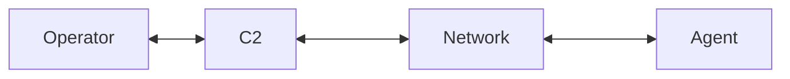
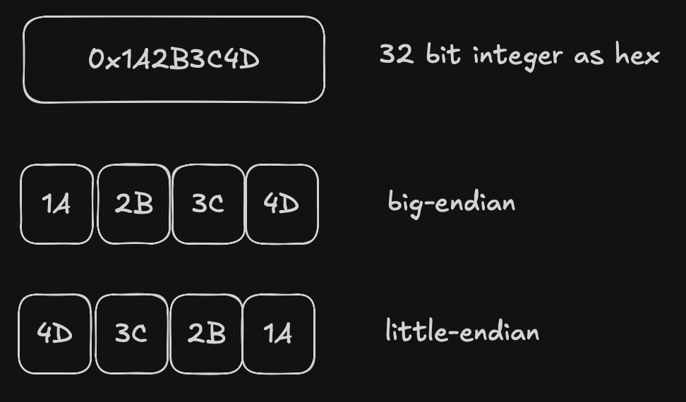

JQR Items
---
Information ending in [#.#] denote sections that covers a JQR item
ex:
- \<instructional information here\> [#.#]
- \<instructional information here\> [#.#, #.#, ...]

This instruction will not cover all the JQR items, and some of the sections are not covered in their entirety
- 6.1 for example has multiple components
<!-- end_slide -->

Overview
---
- What is network programming?
- Why network programming?
- Networking Fundamentals
- Network Programming
    - debugging tools
    - C TCP Server
    - C TCP Client
    - C Threading Intro
    - Python TCP Server
    - Python TCP Client
    - Python Threading Intro
<!-- end_slide -->

What/why network programming?
---
# What
Network programming is programming applications that communicate over the network! too easy!

# Why
As Cyber Capability Developers, we need to write capabilities that can be remotely interacted with. our capabilities normally have an `agent` and `command and control (c2)` relationship, where our `agent` is code running on a remote device, and we issues commands through `c2`



Cyberspace Operatores will interact with the command and control, which will send commands to the agent to take action on target, or operationally prep the environment

# tl;dr

- We (Capability Developers) build the agents/C2's that operators use to accomplish mission
- Agents and C2s can use network communicaiton, the network can be any size (same room, across the world)
<!-- end_slide -->

Networking Fundamentals
---
# Open Systems Interconnected (OSI) Model [12.1]

The OSI model is a *reference* model developed by the International Organization for Standardization (ISO) that provides a common basis for the coordination of standards development for the purpose of systems interconnection.

- tl;dr -- its a model used to standardize the development of communication methods

The OSI model has 7 layers, with layer 7 starting closest to the user as *application data*, or the data users interact with that is for the purpose of network communications. As data progresses down the OSI model, it is encapulated with the next layers information until it is transmitted across physical medium and decapsulated on the other end

# Layers of the OSI Model [12.1]

<!-- incremental_lists: true -->
7. Application   --> layer closest to the user (HTTP/FTP/SMB/CIFS/TFTP/Custom Protocol)
6. Presentation  --> serializes the Application layer data format
5. Session       --> handles the creation of setup/teardown between endpoints
4. Transport     --> provides variable length data transfer between endpoints, ensuring QOL 
3. Network       --> handles the routing of packets between networks
2. Data Link     --> handles the endpoint to endpoint communicaiton within a network
1. Physical      --> handles the conversion of data-link data to bits that run on physcal medium
<!-- incremental_lists: false -->

- The OSI Model is a reference model, there is no "OSI netork stacks" real network stacks use it to ensure standardization
- What "Real" networking stacks do we use today?
    - Internet Protocol Suite - TCP/IP - Consists of (TCP or UDP)/IP
<!-- end_slide -->

Networking Fundamentals
---
# Internet Protocol Suite [12.1]
Often refered to as the TCP/IP model or TCP/IP stack, the internet protocol suite is a real implementation of standards and protocols that covers the layers of the OSI model

The TCP/IP model has 4 layers that encompasses the 7 layers of the OSI Model
- TCP / UDP             -- The Transmission Control Protocol or the User Datagram Protocol
- IP                    -- Internet Protocol
- Link                  -- bits on physcal medium, endpoint communication within a network

<!-- pause -->
The TCP / IP Model mapped to the respective OSI Layers
<!-- new_line -->
7. Application       --------------------
6. Presentation      |    Application   |
5. Session           --------------------
4. Transport         [ TCP / UDP ]
3. Network           Internet Protocl (IP)
2. Data Link         Link Layer
1. Physical

- Layers 5,6,7 are left to the application developer (us) to implement
- Layers 1,2 are combined into a single layer
<!-- end_slide -->

Networking Fundamentals
---
# Inspecting the Internet Protocol Suite

## What exactly is TCP or UDP [12.1]

- RFC 9293 Transmision Control Protocol (TCP) -- https://www.rfc-editor.org/rfc/rfc9293
- RFC 768 User Datagrama Protocol (UDP)       -- https://www.rfc-editor.org/rfc/rfc768

### TL;DR

tcp:
- connection oriented 
- reliable, ensures data delivered in appropriate order
- higher overhead, higher accuracy, higher reliability
- used for situations where data integrity is key (ex: file transfer)

udp:
- connectionless and lightweight
- no guarantee of order delivery
- low overhead, high speed
- used in situations where speed is key (ex: phone call)

UDP/TCP send data to destination ports. Ports reside on endpoints, and normally traffic is coming from or going to a port
<!-- end_slide -->

Networking Fundamentals
---
# Internet Protocol (IP) [12.3]
IP sits at the network layer of the OSI model and routes data between Networks. The IP Layer `routes` packets between networks. A `packet` is the encapsulation of transportation data in IP data.

There are two versions of IP in use:
- ipv4: https://www.rfc-editor.org/rfc/rfc791
- ipv6: https://www.rfc-editor.org/rfc/rfc2460

## tl;dr
- IP Addresses are address on a network, as opposed to ports which are "addresses" on an endpoint, and are used for network routing
- the immediate difference between ipv4 and ipv6 is the amount of available address due to ipv4 being 32-bit and 1pv6 being 128-bit
- there are some additional features provided by ipv6, but those are beyond the scope of this lesson
- network devices that operate on this layer are `routers` and switches that have `routing` capabilities
<!-- end_slide -->

Networking Fundamentals
---
# Internet Protocol (IP) [12.3]
## IP Networks
IP Networks consist of the following components
- `network id`      - an IP address that is the "ID" for a range of IPs that are in the network; the first ip in the network
- `broadcast id`    - an IP address that will relay data to all IPs in the network; the last IP in the network
- `subnet mask`     - a bit mask that can be used to identify if an ip is in the network through `bitwise and`
## IP Network Services [12.2]
- `network gateway` - the IP address of a device that can route packets to external networks; this is generally a router, or routing capable device
- `dhcp`            - Dynamic Host Configuration Protocol
- `dns`             - Domain Name Service

<!-- end_slide -->

Networking Fundamentals
---
# Link Layer [12.3]
The Link layer deals with the physical communication between computer. electrons along a twisted pai ethernet cable, light in a fiber optic cable, radio waves radiating off a wireless access point. regardless of the medium, and the data being transfered, packets from the IP, or network layer, are logically encapsulated into Ethernet Frames, and then transmitted across an Ethernet medium. the `switching` of ethernet frames, or the "sending of frames to the right endpoint" is done through the usage of hardware addresses, or media access control (MAC) address. MAC addresses are "unique" to a network device (network interface cards).

# tl;dr
- Ethernet (physical medium)
- Ethernet Frame (logical encapsulation
- media access control (MAC) addresses are unique to each device
- devies that operate on this layer are `switches`, `wireless adapters`, `network interface cards`, `hubs`. never use hubs

When data is sent from one device to another on the *same* network, the nearest switch will forward the frames.

# Adress Resolution Protocol (ARP) [12.2]
ARP is a protocol that sits inbetween the link layer and the IP layer and each switch on a network maintains an ARP table. Periodically, the network switch will "ask" all the computers on its network "what is your IP address?" and keep a MAC to IP resolution table. This is helpful because the IP address of an endpoint can change, but a MAC address (normally) cannot, and allows endpoints to send communication via IP address instead of needing to know MAC addresses.
<!-- end_slide -->

Networking Fundamentals
---
# Berkley Sockets
- for the purpose of this class, all our code will live in the application layer on top of the TCP/IP model
- Operating Systems abstract the data link layer, and provide built in capabilities for the TCP, UDP, and IP modules
```
--------------------
|    Application   |   <--- Our code
--------------------
[ TCP / UDP ]          ------------------------
Internet Protocl (IP)  Operating System Managed
Link Layer             ------------------------
```

- the goto programming interface for internet domain communication (and unix domain communication) is `berkley sockets`
- `berkley sockets` eventually evolved into `posix sockets` but are still commonly called `berkley sockets`

# Sockets
- a `socket` is a combined ip address and port that describes the endpoints address on the network, and the applications "address" on the endpoint
    - `127.0.0.1:5555`
    - `[::1]:5555`
<!-- end_slide -->

Network Programming -- debugging tools
---
# Tools
## netcat
- used to create arbitraty UDP and TCP connections, send arbitraty data
## gdb
- GDB Dashboard https://github.com/cyrus-and/gdb-dashboard
    - "step" through C code as it is executing. must compile as debug binary
    - a helpful stylistic overlay for GDB that shows helpful information while debugging with GDB

## pdb
- python debygger. allows you to step through python code as it is executing
- built in `breakpoint()` function. use it anywhere in your code, drop into a basic interpreter

## python interpreter
- just use the interpreter to inspect code.
- `python3 -i <file.py>` to drop into interpreter after file runs
<!-- end_slide -->

Network Programming -- C TCP Server
---
# What is a TCP Server?
- a TCP server is a socket used to coordinate connections
- client connection requests come in on the server socket, and the operating system creates a new socket for the connection
- the server socket messages the source of the incomming message the properties of the connection socket
- the client and the server application use the new connection socket for communication
- this connection sequence is handled by the operating system
- messages are never passed at the application level through the server socket
- the server socket can be closed, as it is technically indepenent of the client sockets created after
<!-- new_line -->
<!-- new_line -->
- placeholder for tcp server connection coordination
<!-- end_slide -->

Network Programming -- C TCP Server
---
# steps for creating a tcp server
1. create a `socket`
2. `bind` the socket to an ip address and a port
3. set the socket to `listen`
4. `accept` client connections
5. `send` and `recv` data
6. ???
7. profit
<!-- end_slide -->

Network Programming -- C TCP Server
---
# Creating a Socket [12.7]
`man socket`

```c +line_numbers
#include <sys/socket.h> // for socket

int socket(int domain, int type, int protocol);
```

for many of these networking functions `#include <netdb.h>`. netdb.h contains macros for many networking related constants such as human readable defines for `protocol` value

- successfull calls to `socket` return a positive int known as a `file descriptor`. operations on this number tell the kernel to perform operations on the associated socket
- failure results in a -1, and a thread unique variable labeled `errno` is set
    - `#include <errno.h>` and inspect the value of `errno` for specific errors

On success, we have an "empty" socket. the OS has prepared a socket for us, but it doesnt have an IP or a Port assigned

# debugging
- use `printf` statements to print your new file descriptor or errno
- use `gdb` to inspect the values at runtime
<!-- end_slide -->

Network Programming -- C TCP Server
---
# `bind`ing [12.7]
`man bind`

```c +line_numbers
#include <sys/socket.h>

int bind(int sockfd, const struct sockaddr *addr, socklen_t addrlen);
```

- we have a sockfd, thats the socket file descriptor
- looks like we need a `struct sockaddr *` and a `socklen_t`

## `man sockaddr` [12.7]
- looks like we need to construct a our socket address information
- `sockaddr_in` is the struct for ipv4:port
- `sockaddr_in6` is the struct for ipv6:port

focusing on `sockaddr_in`, we need values for the following struct properties:
- `sa_family_t sin_family`   -- this tells the `bind()` call what type of IP address we will use
- `in_port_t sin_port`       -- this tells the `bind()` call which port to use. this needs to be in `network byte order`
- `struct in_addr sin_addr`  -- this is a struct describing the ip address, its properties are also in `network byte order`
<!-- end_slide -->

Network Programming -- C TCP Server
---
## network byte order, host byte order, endianness? [6.1]
`endianness` is the order in which `bytes` are organized and addressed in memory, and the order of `bytes` as they are transmitted across a network


- This diagram has a 32bit integer arranged in big-endian and little-endian
<!-- end_slide -->

Network Programming -- C TCP Server
---

### Why does this matter?
Due to some technical reasons, some systems arrange numeric values in little-endian and some in big-endian.
- TCP/IP like most network protocols are standardized on big-endian: https://www.rfc-editor.org/rfc/rfc1700
- most end user devices operate on little endian for ease of computations found in user applications

how do i know the endianess of my system and how do I convert my byte order? [12.7]
- `man byteorder`  -- original, less specific conversion functions
- `man endian`     -- newer, more robust conversion functions

the `implementation` of these functions will be specific to the CPU architecture you are writing on, so calling `htonl` on a network-byte order, or big-endian, system will not change the byte order at all. but using these functions allows you to create capabilities that can execute on network or host order devices

### note: only need to convert *integer types*, strings, floats, doubles, etc, can stay in their same byte order
<!-- end_slide -->

Network Programming -- C TCP Server
---
## back to our `struct sockaddr_in`
```c +line_numbers
#include <sys/socket.h>
#include <arpa/inet.h>

struct sockaddr server_addr = {0};
server_addr.sin_family = AF_INET   // from documentation
server_addr.sin_port = htons(5555) // convert our 5555 short value into network byte order
server_addr.sin_addr = ???         // another rabbit hole, what is this `struct in_addr`?
```

the sin_addr property of the sockaddr_in is as follows:
```c +line_numbers
struct in_addr
{
    in_addr_t s_addr;
};

typedef uint32_t in_addr_t;
```

- we need to create a uint32_t representation of an ipv4 address, from the RFC it is 4 8 byte octets.
- we can use bit shifting to create an ip address from out 4 octets
<!-- end_slide -->

Network Programming -- C TCP Server
---

```c +line_numbers
uint32_t ip = 0;
ip |= 127 << 24;
ip |= 0   << 16;
ip |= 0   << 8;
ip |= 1;

server_addr.sin_addr.s_addr = htonl(ip);
```

now we can bind our socket to this sockaddr_in [12.7]
```c +line_numbers
status = bind(server_fd, (struct sockaddr*)&server, sizeof(struct sockaddr_in));
```

finally, we can listen, and then accept new connections [12.7]
```c +line_numbers
status = listen(server_fd, 20);

struct sockaddr client_addr = {0};
socklen_t client_len = 0;

// accept is a blocking call. the program will block until a connection comes in
int client_fd = accept(server_fd, &client_addr, &client_len);
```
<!-- end_slide -->

Network Programming -- C TCP Server
---
# send/recv/close

now that we have a connection socket, we can `send` and `recv` data, then we can `shutdown` and `close` the socket file descriptor once it is no longer needed

`man send` [12.7]
```c +line_numbers
#include <string.h>

char *message = "hello, world!";
size_t len = strlen(message);

// send is blocking, and may also partially send data
ssize_t bytes_sent = send(client_fd, message, len, 0);
```

`man recv` [12.7]
```c +line_numbers
char buffer[16] = {0};
size_t len = 15;

ssize_t bytes_recv = recv(client_fd, buffer, len, 0);
```

`man close`
```c +line_numbers
// close your file descriptors, it can be an OPSEC thing, and there is technically a FD limit
close(client_fd);
```
<!-- end_slide -->

Network Programming -- C TCP Server
---
# `send`ing and `recv`ing Variable Length Data and Data Serialization / Deserialization

`send` and `recv` both operate on a `void *buff` pointer, and send/recv up to `size` bytes from that address. This is fine when we are sending contiguous data that we know the size of, but what about potentially non-contiguous data, or data of variable length?
- send and recv are blocking calls. If the client and server are not coordinated, both applications can be stuck in a blocking state
- if either end needs to send variable length data, how does the receiving end know how many bytes to receive for?
- to solve both these problems, we need data serialization and to define a protocol

# defining our protocol
- A protocol is a predefined way of communitcatin
- it can be as simple as length of the message, followed by the message
```
[uint32_t length][void *message]
```
- when receiving a message, an endpoint can first read a uint32_t to determine the length of the message, then read `length` bytes
- our `void *message` can be an encapsulated message, parsed by looking at the first `uint8_t` to determine the type, then parsing the rest of the message based off the type
```
[uint8_t type][void *data]
```
<!-- end_slide -->

Network Programming -- C TCP Server
---
# getting our bytes in a row
- given the following struct, lets create a byte array that can be sent across the network handling for variable sized messages
```c +line_numbers
struct message {
    uint8_t type;
    uint32_t length;
    void *value;
};
```
- when receiving data, an endpoint will always read a `sizeof(uint8_t)` to determine the type of incoming message, followed by a `sizeof(uint32_t)` to determine the final `length` to read to obtain `value`
- when sending data, we need to put our values in a contiguous space so `send` can send the bytes in the proper order
- `calloc` and `memcpy` can be used to allocate a buffer, and copy values into the buffer
```c +line_numbers
#include <string.h> // memcpy is here for some reason

// lets say we already have a `struct message` stack allocated labeled `message` and we are just serializing it

int offset = 0;
uint32_t length = htonl(message.length);
uint8_t type = htons(message.type);
size_t total_size = message.length + sizeof(uint8_t) + sizeof(uint32_t);
char *buffer = (char *)calloc(total_size, sizeof(char));

memcpy(buffer, &type, sizeof(uint8_t));
offset += sizeof(uint8_t);

memcpy(buffer + offset, &length, sizeof(uint32_t));
offset += sizeof(uint32_t);

memcpy(buffer + offset, message.value, message.length);
// I now have a contiguous buffer I can send
ssize_t bytes_sent = send(client_fd, buffer, total_size, 0);

```
<!-- end_slide -->

Network Programming -- C TCP Server
---
# recv the buffer
- on the receiving end, we can create a message struct and fill properties
```c +line_numbers
struct message message = {0};
recv(fd, &message.type, sizeof(uint8_t), 0);
recv(fd, &message.length, sizeof(uint32_t), 0);

message.type = ntohs(message.type);
message.length = ntohl(message.length);

message.value = calloc(message.length, sizeof(char));
recv(fd, message.value, message.length, 0);
```
- we have successfully deserialized a byte stream from the network into structured data
- the send and receive example do not handle partial read/writes
    - due to the nature of I/O, the operating system may only send *some* of the data before returing from `send` and `recv`
    - handling partial `send` and `recv` will be covered in the next slides
<!-- end_slide -->

Network Programming -- C TCP Server
---
# handling a partial `send` or `recv`
- `send` and `recv` operate on a memory address, and `send`/`recv` `length` bytes stating at that address
- both functions return the number of bytes that were actually transmitted
- we can use pointer arithmetic to loop over a buffer until we have transmitted the expected amount of data

# function signature for custom send_all function
<!-- pause -->
```c +line_numbers
ssize_t send_all(int fd, void *buffer, size_t length, int flags);
```
# send_all implementation
<!-- pause -->
```c +line_numbers
ssize_t send_all(int fd, void *buffer, size_t length, int flags) {
    ssize_t total_tx = 0;
    size_t delta = 0;

    while (total_tx != length) {
        delta = send(fd, buffer + total_tx, length - total_tx, flags);
        if (-1 == delta) {
            // check errno, print error, yada yada
            total_tx = -1;
            goto END;
        }

        total_tx += delta;
    }

END:
    return total_tx;
}
```

- steps for a partial `recv` would be simliar with a recv function call and filling a dst buffer rather than reading from a src buffer
<!-- end_slide -->

Network Programming -- C TCP Client
---
# steps for creating a tcp client
1. create a `socket`
2. `connect` the socket to a remote socket (ip:port)
5. `send` and `recv` data
6. ???
7. profit

# resuing syscalls
- creating a connection to an already established listening socket seems trivial now that we have the primative functions covered
- we have already discussed the mechanics of creating a `socket`, and `send`ing and `recv`ing data.
- we have also reviewing mechanics for handling partial send/recv

# connect is the only new call
`man connect`
- connect takes the same parameters that we delt with bind
- the OS will will dynamically assign an ip and port to the local socket, and connect to the sockaddr destribed in the `connect` call
```c +line_numbers
#include <sys/socket.h>
#include <arpa/inet.h>

struct sockaddr_in server_addr = {0};
int client_fd = socket(AF_INET, SOCK_STREAM, IPPROTO_TCP);

uint32_t ip = 0;
ip |= 127 << 24;
ip |= 0   << 16;
ip |= 0   << 8;
ip |= 1;

server_addr.sin_addr.s_addr = htonl(ip);
server_addr.sin_port = htons(5555);
server_addr.sin_family = AF_INET;

int status = connect(client_fd, (struct sockaddr*)&server_addr, sizeof(struct sockaddr_in));
```
<!-- end_slide -->

Network Programming -- C TCP Client
---
# review
- A TCP client differs from a TCP Server in that a client `connect`s to a `listen`ing server that is `accept`ing connections
- before a client socket can connect:
    - a server must create a `socket`
    - `bind` the socket 
    - `listen` on the socket
    - start `accept`ing new connections
<!-- new_line -->
- once establised, a client can:
    - create a `socket` for remote connection
    - call `connect` on the socket with the remote socket address
<!-- new_line -->
- once a connection is established, the client and server need to adhear to their communication protocol to ensure successfull data transmission and to ensure data is not corrupt at de/serialization
    - who is talking first.
    - what do messages look like
    - what do responses look like
    - document the protocol and sequence diagram for C2/Agent Communication
        - https://en.wikipedia.org/wiki/Sequence_diagram

- in class echos server / client
<!-- end_slide -->

Network Programming -- `getaddrinfo`
---
# memes
- for the TCP server and client sections, we hand crafted our sockets
- farm to table, organic, artisinal, gourmet
- what if there was another way. introducing GMO sockets with `getaddrinfo`

<!-- pause -->
# getaddrinfo
`man getaddrinfo`

- `getaddrinfo` is a posix addition to the berkely socket api allowing the rapid creation of socket configurations given an endpoint `node`, `service`, options or `hints`, and pointer to an output `response` pointer
```c +line_numbers
#include <sys/types.h>
#include <sys/socket.h>
#include <netdb.h>

int getaddrinfo(const char *restrict node,
                const char *restrict service,
                const struct addrinfo *restrict hints,
                struct addrinfo **restrict res);

void freeaddrinfo(struct addrinfo *res);

const char *gai_strerror(int errcode);
```

- `getaddrinfo` will return an error code on failure, we can get the string representation of that error with `gai_strerror()`
- on success, our `struct addrinfo **restrict res` argument will contain a linked list of `addrinfo` structures we can use in subsequent `socket`, `bind`, `listen`, `accept`, and `connect` calls
- `freeaddrinfo` is provided as a way to clean up the dynamically allocated linked list returned by `getaddrinfo`
<!-- end_slide -->

Network Programming -- `getaddrinfo`
---
getaddrinfo has some nice features.
1. the `node` can be provided as a hostname, ipv4, or ipv6 address as a string
2. the `service` can also be a string shorthand or a string version of a port number
    - ex: `service` can be "ssh" or "22"
    - if you know the port number, its better to provide the number
    - the service names are resolved to "known defaults", and might not be the port you are looking for

# getaddrinfo in action
```c +line_numbers
#include <sys/types.h>
#include <sys/socket.h>
#include <netdb.h>

int status = 0;
struct addrinfo hints = {0};
struct addrinfo *response = NULL;

hints.ai_family = AI_UNSPEC;
hints.ai_socktype = SOCK_STREAM;
hints.ai_flags = AI_PASSIVE; // use this if the `node` is NULL

status = getaddrinfo("127.0.0.1", "5555", &hints, &response);
```
- think of the `hints` struct as our configuration. I want addrinfo configurations that match this config.
- `hints.ai_flags = AI_PASSIVE` can be used when creating addrinfo for server sockets. it tells addrinfo to "fill in the systems IP address", and the `node` parameter would be NULL.
- when creating a connection, `hints.ai_flags` would be unset, and the remote node would be provided by the caller
<!-- end_slide -->

Network Programming -- `getaddrinfo`
---
# using `struct addrinfo *response` to make a TCP server socket
- a successfull call to `getaddrinfo` will yield a linked list of addrinfo structs
- linked lists are a data type that point to the next item, or `NULL` if the current item is the last
- more about linked lists in the data structure slides
```c +line_numbers
int socketfd = -1;
int status = -1;

// this will loop through each node in the linked list
for (struct addrinfo *index = response; NULL != index; index = index->ai_next) {
    socketfd = socket(index->ai_family, index->ai_socktype, index->ai_protocol);
    if (-1 == socketfd) {
        continue; // try the next link in the list
    }

    status = bind(socketfd, index->ai_addr, index->ai_addrlen);
    if (-1 == status) {
        goto CLOSE_FD;
    }

    status = listen(socketfd, 20);
    if (-1 == status) {
        goto CLOSE_FD;
    }

    break;

CLOSE_FD:
    close(socketfd);
}

freeaddrinfo(response);
```
- we break at the end of the loop because we have a successfully connected, bound, and listening socket that is ready to accept
- use the `freeaddrinfo` after the loop to free the dynamically linked list created by `getaddrinfo`
<!-- end_slide -->

Network Programming -- `getaddrinfo`
---
# using `struct addrinfo *response` to make a TCP client socket
```c +line_numbers
int socketfd = -1;
int status = -1;

// this will loop through each node in the linked list
for (struct *addrinfo index = response; NULL != index; index = index->ai_next) {
    socketfd = socket(index->ai_family, index->ai_socktype, index->ai_protocol);
    if (-1 == socketfd) {
        continue; // try the next link in the list
    }

    status = connect(socketfd, index->ai_addr, index->ai_addrlen);
    if (-1 == status) {
        goto CLOSE_FD;
    }

    break;

CLOSE_FD:
    close(socketfd);
}

freeaddrinfo(response);
```
- the primary difference between the Server and Client examples are the calls inside the for loop
- use the `freeaddrinfo` after the loop to free the dynamically linked list created by `getaddrinfo`
<!-- end_slide -->

Network Programming -- `getaddrinfo`
---
# demo - rewriting our client/server to use `getaddrinfo`
<!-- end_slide -->

Network Programming -- C Threading Intro
---

# Why Threading?
- our current tcp server handles requests `concurrently`, or operations happen one at a time
- threading is a mechanism for creating another block of executable code that runs `asyncronously` or at the same time as our main block of code
- our `accept`, `recv`, and `send` calls are blocking. The main thread of execution will no longer run untill that call is complete
- our `accept` call can be blocked in one thread, while a separate thread handles the `recv` and `send` calls of a specific client

# posix threading with `pthread` (posix thread)
- `man pthreads`            -- outlines posix threads holistically
    - `man pthread_create`  -- describes the creation of threads
    - `man pthread_join`    -- describes `joining` on pthreads to wait on a thread and optionally receive the output from a completed thread
    - `man pthread_detach`  -- `detatch` from a thread, normally used when the thread results and resources are not needed by the main thread.

## pthread resource sharing
- pthreads share the same `heap` as the main process thread. a pointer to a data structure can be passed to a thread and the new thread can access it
- the file descriptor (fd) table is copied at `thread creation time`. the `child thread` will have access to all the fd's the parent thread has when it was created, but not new ones opened after creation

# threads in action
- our main server might need to handle multiple clients, but our client handling code is client specific
- our client handling code can be encapsulated into its own function
- our main thread receives a new connection, creates a new thread with the client handling function
- the main thread goes back to `accept`, which will block while it waits for another connection
- the client thread will `read` and `recv`, blocking only itself.

# thread dangers
- if threads will be accessing the same data, access to that data needs to be `synchronization`
- these synchronization techniques are beyond the scope of the networking slides but resources can be found here:
    - `man pthread_mutex_init`
    - `man pthread_cond_init`
<!-- end_slide -->

Network Programming -- C Threading Intro
---
# Creating a thread
- our thread function must be return a `void *` and take a `void *` as its only argument. this lets us optionally return data of any type, while also accepting data of any type

## handle_client example
- this is a simple example that doesnt handle partial send/recv or perform data serialization
```c +line_numbers
struct thread_ctx {
    int fd;
    // other data a specific thread might need
};

void *handle_client(void *context) {
    struct thread_ctx *ctx = (struct thread_ctx *)context; // cast input to expected type

    char buffer[256] = {0};
    ssize_t bytes_tx = 0;

    while (1) {
        // read message from client
        bytes_tx = recv(ctx->fd, buffer, 256, 0);
        // do stuff with message
        // send response
        bytes_tx = send(ctx->fd, buffer, 256, 0);
    }

    close(ctx->fd);

    // the main thread and child threads all share the same heap,
    // freeing it here frees this pointer in all threads.
    // do NOT free in the main thread or a double free and segfault can happen
    free(ctx);

    return NULL; // can just return NULL if no output
}
```
<!-- end_slide -->

network programming -- c threading intro
---
## main example
- in this example, I am ommitting the network related includes as well as the setup/teardown of a TCP server
```c +line_numbers
#include <pthread.h>

int main(int argc, char **argv) {
    int server_fd = 0;
    int client_fd = 0;
    struct thread_ctx *client_ctx = NULL;
    pthread_t tid = 0;

    // implement a server

    while (1) {
        client_fd = accept(server_fd, NULL, NULL);
        client_ctx = (struct client_ctx *)calloc(1, sizeof(struct client_ctx));

        client_ctx->fd = client_fd;
        pthread_create(&tid, NULL, handle_client, client_ctx);
        pthread_detach(tid);
    }
}
```
- with this implementation, all the client related logic is handled in the previously declared `handle_client` function
- when a connection is accepted, it is immedialed passed into a new thread
- in this toy example, we don't need any output of the thread, and detatch it from the main thread
<!-- end_slide -->

network programming -- c threading intro
---
# demo: refactoring our server to handle multiple connections
<!-- end_slide -->

network programming -- Python TCP Server
---
# TCP Server
- implementing a server in python is less laborsome
- the `socket` library contains the majority of the function calls required
```python +line_numbers
import socket

HOST = "127.0.0.1"
PORT = 5555

sockaddr = (HOST, PORT)
server = socket.socket(socket.AF_INET, socket.SOCK_STREAM, socket.IPPROTO_TCP)
server.bind(sockaddr)
server.listen(20)
client = server.accept()
```
# explanation
- 1   imports the socket library, which is part of the standard python library
- 3-4 create some "global" variables
- 6   hand craft our "artisinal" sockaddr, in python the bind call is expecting a tuple of a string and int for the ip and port number
- 7   create a socket, notice the parameters mirror the c socket call, with the socket related constants being accessed through the socket module. the result of this call is a `socket.socket` object, which is an abstraction around the socket file descriptor
- 8   `server.bind` binds the fd abstracted by the `socket.socket` to the provided "sockaddr" tuple
- 9   `server.listen` calls listen on the `socket.socket` object, with the provied backlog
- 10  `server.accept()` will block, accepting a connection. the return of accept is a tuple with index 0 being the client socket and index 1 being the client sockaddr tuple
- 10  line 10 could be rewritten as `client, addr = server.accept()` to unpack the tuple in one call
<!-- end_slide -->

network programming -- Python TCP Server
---
# `socket.getaddrinfo`
- the socket module provides a wrapper for `getaddrinfo`

```python +line_numbers
import socket

HOST = "127.0.0.1"
PORT = 5555
server = None # for our socket, we need a scope variable to assign outside our loop

response = socket.getaddrinfo(HOST, PORT, family=AF_UNSPEC, type=socket.SOCK_STREAM, flags=socket.AI_PASSIVE)

for item in response:
    af, socktype, proto, canonname, sa = item;

    try:
        server = socket.socket(af, socktype, proto);
    except OSError as msg:
        server = None
        continue
    try:
        server.bind(sa)
        server.listen(20)
    except OSError as msg:
        server.close()
        server = None
        continue
    break # if we make it this far, we have a good socket ready to accept

if server is None:
    print("could not open a socket")

conn, addr = server.accept()
```
<!-- end_slide -->

network programming -- Python TCP Server
---
# `socket.create_server`
- similar to the C function demo'd in class. this is a convenience function used to create a `SOCK_STREAM` style socket (TCP) ready to `accept()`

```python +line_numbers
import socket

HOST = "127.0.0.1"
PORT = 5555

server = socket.create_server((HOST, PORT))
conn, addr = server.accept()
```

# Options!
- python is going to give you access to the system calls (wrapped in a python function) with `socket.socket()`, `socket.bind()`, `socket.listen()`
- python even exposes a python wrapped version of `getaddrinfo()` with `socket.getaddrinfo()`
- python provides some convenience function that you would have to implement yourself in C
- use the layer of abstraction that works for your use case! there is nothing wrong with calling `socket.create_server()` if you arent using the expanded functionality of hand crafting your connection
- these function might have additional parameters that can expand the functionality. become familiar with the python documentation to increase your foundational understanding of python networking
<!-- end_slide -->

network programming -- Python TCP Client
---
# With Sockets
```python +line_numbers
import socket

HOST = "127.0.0.1"
PORT = 5555

client = socket.socket(socket.AF_INET, socket.SOCK_STREAM, socket.IPPROTO_TCP)
client.connect((HOST, PORT))
```

# With `socket.getaddrinfo`
```python +line_numbers
import socket

HOST = "127.0.0.1"
PORT = 5555
client = None # for our socket, we need a scope variable to assign outside our loop

response = socket.getaddrinfo(HOST, PORT, family=AF_UNSPEC, type=socket.SOCK_STREAM)

for item in response:
    af, socktype, proto, canonname, sa = item;

    try:
        server = socket.socket(af, socktype, proto);
    except OSError as msg:
        client = None
        continue
    try:
        s.connect(sa)
    except OSError as msg:
        client.close()
        client = None
        continue
    break # if we make it this far, we have a good socket ready to send/recv

if client is None:
    print("could not open a socket")
```
<!-- end_slide -->

network programming -- Python TCP Client
---
# with `socket.create_connection`
- like with `socket.create_server`, this will create a SOCK_STREAM type socket
```python +line_numbers
import socket

HOST = "127.0.0.1"
PORT = 5555

client = socket.create_connection((HOST, PORT))
```
<!-- end_slide -->

network programming -- Python Serialization
---
# serialization and deserialization
- before we send and recv data with python, we will review data serialization with the `struct` module
- as with C, we send bytes over the network and not programming logical constructs
- we need a way to serialize our python data in the same way we serialize our C data
- https://docs.python.org/3/library/struct.html
    - https://docs.python.org/3/library/struct.html#byte-order-size-and-alignment
    - https://docs.python.org/3/library/struct.html#format-characters

# `struct.pack`

the `pack` function of the `struct` module will pack a sequence of arguments into a `bytes` object. the resulting `bytes` object can be passed to our `send/recv` functions

## packing a single integer

- the format string `"!I"` states the output will be network byte order (`!`) and the first series of bytes is an unsigned int of 4 bytes (`I`)
- the arguments after the format string are the parameters to be serialized in the order they appear in the format string

```python +line_numbers
import struct

some_int = 12345

payload = struct.pack("!I", some_int)
```
<!-- end_slide -->

network programming -- Python Serialization
---
## packing a `type`, `length`, `value` style packet
```python +line_numbers
class Message:
    def __init__(self, type, value):
        # we dont provide a length of value, because python knows the size
        self.type = type
        self.value = value

    def serialize(self):
        value_bytes = self.value.encode()
        length = len(value_bytes)
        format_string = f"!BI{length}s"
        payload = struct.pack(format_string, self.type, length, value_bytes)
        return payload

message = Message(0, "this will echo to the screen!")
message.serialize()
```
lets `unpack` whats happening here
- we have a python class version of our c message struct
- we have a constructor that takes a type and a value. our values are strings, and python knows the length of a string with the `len()` function, so we dont need it as a property
- because this is a class, our `Message` objects can serialize themselves!

The `format_string` is being dynamically created based on the values provided to the object at creation time
- our C struct `type` property is an `uint8_t` and the format specifier for that is `B`
- next, our C struct `length` property is an `uint32_t` and the format specifier for that is `I`
- lastly, we need to convert our `value` string to bytes with the string `.encode()` function. we use its length to set the final specifier of `{length}s`. the length is used to tell pack how many bytes to pack into the `bytes` output

Using the features of OOP, we have created a new Class for message passing that we can serialize when needed and we can call `len()` on the resulting bytes object to determine the amount of bytes in the fully packed messge
<!-- end_slide -->

network programming -- Python send
---
# send
- now that we have serialized data, we can send and recieve our bytes
- `send` and `recv` are methods on socket objects.
- just like with C, these functions can partial send/recv and iteration can be used to solve this issue


## using iteration
```python +line_numbers
# using a previously created client socket
message = Message(0, "this will echo to the screen!")
payload = message.serialize()
bytes_tx = 0

while bytes_tx < len(payload):
    # will evaluate to the bytes at the index up until the end of the payload bytes object
    delta = client.send(payload[bytes_tx:-1]

    bytes_tx = bytes_tx + delta

```

## using builtin sendall function
```python +line_numbers
# using a previously created client socket
message = Message(0, "this will echo to the screen!")
payload = message.serialize()
bytes_tx = 0
client.sendall(payload)
```
<!-- end_slide -->

network programming -- Python recv
---
# recv
- the recv call of a socket object will return the bytes received from the call
- to handle partial recvs, we can use iteration to append bytes to a bytearray
    - bytes are immutable, so concatenating bytes could become exponentially expensive
    - a bytearray will contain the sequence of bytes that will be used to create the resulting bytes object
- once a complete message has been received, we can concatenate the bytearray to bytes

```python +line_numbers
MESSAGE_HEADER = 40 # a uint8_t and a uint32_t

bytes_tx = 0
payload = bytearray() # we use a bytearray() because "bytes" are immutable

while bytes_tx < MESSAGE_HEADER:
    chunk = client.recv(MESSAGE_HEADER - bytes_tx)
    if chunk is None:
        # recv of zero normally means conneciton has closed
        pass
    payload.extend(chunk)
    bytes_tx = bytes_tx + len(chunk)

payload = bytes(payload)
```
<!-- end_slide -->

network programming -- Python deserialization
---
# deserialization
now that we have received a buffer, we can use `struct.unpack` to deserialize it.
- Similar to the serialization process, we provide a format string for how the data exists in the packed bytes.
- the results of struct.unpack is a tuple containing a number of items declared in the format string. if 1 item is declared, the result is a tuple with 1 item
- the order of items in the tuple are the same order as declared in the format string

# `struct.unpack`

```python
import struct

# recv bytes and assign to payload

format_string = "@H"

# the format string specifies an unsigned short, or our uint8_t
# message_type will be a tuple contianing a single item
message_type = struct.unpack(format_string, payload)
message_type[0] # index 0 to access the single item
```

# unpacking the tuple
- a tuple can be "unpacked" or assigned to individual values
```python +line_numbers
# in this example, I am expecting a tuple of 3 items, each outputting to their respective a, b, c, for the 0, 1, 2 index
a, b, c = struct.unpack(....)
```

- unpacking a single item tuple requires a variable with a trailing comma
```python +line_numbers
message_type, = struct.unpack(format_string, payload)
```
<!-- end_slide -->

network programming -- Python Threading Intro
---
# `threading` module
- threading in python is similar to threading in C, but with python syntax!
- a thread object can be created with a "target" function
- positional arguments can be passed as a tuple with the "args" parameter

```python +line_numbers
import threading

def handle_client(client):
    while True:
        payload = client.recv()
        ## handle payload, send response
        bytes_tx = client.send()

# create a TCP server socket assigned to `server`

threads = []

while True:
    conn, addr = server.accept()
    t = threading.Thread(target=handle_client, args(client,))
    t.start()
    threads.append(t)

for t in threads:
    t.join()
```
<!-- end_slide -->

network programming -- Python Threading Intro
---
# hands on:
1. create a python server that replicates the c server protocol
2. create a python client that replicates the c client protocol
3. ???
4. profit
